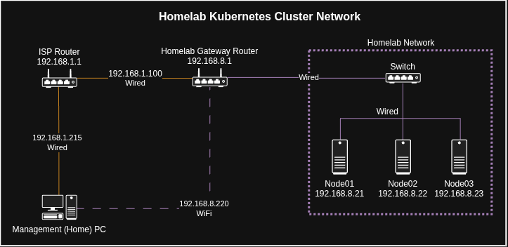

# Kubernetes Homelab: Proxmox, Terraform, Ansible, and Kubernetes

Infrastructure as Code for a small bare-metal Kubernetes homelab. This repository configures a three-node Proxmox VE cluster, provisions six Ubuntu virtual machines, and builds a Kubernetes cluster with containerd, kubeadm, Helm, and Cilium.

> **Companion repository:** This project supports the **Kubernetes Homelab** article series, particularly the infrastructure automation and Kubernetes installation walkthroughs. The documentation here is also **standalone**: you can follow the instructions below without reading the articles.
>
> 
> Previously published articles:
> - [Part 1: Physical Network](https://www.linkedin.com/pulse/kubernetes-homelab-part-1-physical-network-rasul-abdulmagomedov-vafwe/)
> - [Part 2: Automating Proxmox Installation with PXE/iPXE](https://www.linkedin.com/pulse/kubernetes-homelab-part-2-automating-proxmox-pxe-abdulmagomedov-fieqe/)
>
> The example below shows the network setup used throughout the article
> 
> 
> The [Homelab Barebone repository](https://github.com/nekrorat/homelab-barebone) covers the earlier PXE/iPXE and automated bare-metal installation stage. **This repository begins with Proxmox VE already installed** on the three physical hosts. The IaC and Kubernetes articles are part of the same series, but this README does not require their publication links.

**Testing and verification:** See [tests.md](tests.md) for prerequisite checks, verification after each phase, optional Terraform tests, and Kubernetes smoke tests.

## What this repository builds

The example environment uses three physical mini PCs, each running Proxmox VE 9, and six Ubuntu 24.04 VMs:

| Proxmox host | Host IP | Kubernetes VM | VM ID | VM IP |
| --- | --- | --- | --- | --- |
| pve01 | 192.168.8.21 | control-plane-01 | 101 | 192.168.8.31 |
| pve01 | 192.168.8.21 | worker-01 | 102 | 192.168.8.32 |
| pve02 | 192.168.8.22 | worker-02 | 103 | 192.168.8.33 |
| pve02 | 192.168.8.22 | worker-03 | 104 | 192.168.8.34 |
| pve03 | 192.168.8.23 | worker-04 | 105 | 192.168.8.35 |
| pve03 | 192.168.8.23 | worker-05 | 106 | 192.168.8.36 |

The lab LAN is `192.168.8.0/24` with gateway `192.168.8.1`. The default VM shape is **2 vCPUs, 4 GiB RAM, and a 25 GB disk** per VM. The Proxmox Ubuntu Cloud-Init template uses VM ID **9000** on `pve01` and `local-lvm` storage.

Kubernetes uses a single control plane and five workers. The example repository currently selects Kubernetes **1.37**, Helm **v3.19.0**, and Cilium **1.20.4**. Version strings are defined in `kubernetes-config/group_vars/kubernetes.yaml`.

These are **example homelab values**, not a generic production topology. Replace addresses, storage names, VM sizes, and other environment-specific settings before applying the automation elsewhere.

## Repository layout

```text
.
├── proxmox-config/
│   ├── configure-proxmox.yaml       # Proxmox hosts, cluster, API token, Ubuntu template
│   ├── group_vars/proxmox.yaml      # Template/image settings
│   └── inventory/hosts.ini          # Three physical Proxmox nodes
├── vm-provision/
│   ├── main.tf                      # Six Ubuntu VMs
│   ├── variables.tf                 # VM IDs, node placement, IPs, sizes
│   ├── providers.tf                 # bpg/proxmox provider
│   ├── outputs.tf
│   └── tests/
│       ├── connection/             # Optional Proxmox API read test
│       └── vm-clone/               # Optional throwaway VM clone test
├── ubuntu-config/
│   ├── configure-ubuntu.yaml        # Ubuntu host configuration and console password
│   ├── inventory/hosts.ini          # Kubernetes VM addresses
│   └── vars/credentials.example.yaml
├── kubernetes-config/
│   ├── configure-kubernetes.yaml    # Runtime, kubeadm, workers, Helm, Cilium, smoke test
│   └── group_vars/kubernetes.yaml   # Kubernetes, Helm, and Cilium versions
├── .gitignore
├── README.md
└── tests.md                         # Checks for individual setup steps
```

The four directories represent four execution phases. Run the commands **from the repository root** unless a step specifically says otherwise.

## Prerequisites

You need:

- Three reachable **Proxmox VE 9** installations, already installed on physical hosts. See the [previous repository](https://github.com/nekrorat/homelab-barebone) for the PXE installation stage.
- A management machine with **Git, OpenSSH, Ansible, Terraform, and OpenSSL**. A Linux shell or WSL environment is suitable.
- Sufficient physical RAM and disk capacity for the six VMs, plus a reachable management network.

Clone this repository:

```bash
git clone https://github.com/nekrorat/homelab-proxmox-iac.git
cd homelab-proxmox-iac
```

Before running anything, review the environment-specific values in:

- `proxmox-config/inventory/hosts.ini` and `proxmox-config/group_vars/proxmox.yaml`
- `proxmox-config/configure-proxmox.yaml`, which contains some example-specific cluster and primary-node addresses
- `vm-provision/variables.tf`, which defines VM names, IDs, addresses, resource sizes, storage, and SSH public-key path
- `ubuntu-config/inventory/hosts.ini`, which must correspond to the Terraform-created VMs
- `kubernetes-config/group_vars/kubernetes.yaml`, which selects component versions

Do not apply the default IP addresses or VM IDs to an environment where they are already in use.

## Phase 1: Configure Proxmox with Ansible

`proxmox-config/configure-proxmox.yaml` runs the following tasks in order.

| Step | Task group | Verification |
| --- | --- | --- |
| 1.3.1 | Configure Proxmox Package Repositories | [Check](tests.md#step-131-verify-proxmox-package-repositories) |
| 1.3.2 | Customize the Subscription Reminder | — |
| 1.3.3 | Upgrade Packages and Reboot | — |
| 1.3.4 | Configure Hostnames and Name Resolution | — |
| 1.3.5 | Check Connectivity Between Hosts | — |
| 1.3.6 | Create the Proxmox Cluster | [Check](tests.md#step-136-verify-proxmox-cluster-membership) |
| 1.3.7 | Configure Terraform API Access | [Check](tests.md#step-137-verify-terraform-api-access) |
| 1.3.8 | Download the Ubuntu Cloud Image | — |
| 1.3.9 | Create the Ubuntu Base VM and Import Its Disk | — |
| 1.3.10 | Configure Cloud-Init and Convert the VM into a Template | [Check](tests.md#step-1310-verify-the-ubuntu-cloud-init-template) |

### First-time SSH setup

Complete this setup for first-time installs or after PXE/iPXE reinstallation.

Ansible connects over SSH as `root` (see `proxmox-config/inventory/hosts.ini`). A fresh Proxmox installation has a root password, but **does not automatically trust the SSH key on your management PC**. You must authorize your public key before Ansible's first connectivity test.

On your **management PC**, check whether the default key exists:

```bash
ls -l ~/.ssh/id_ed25519.pub
```

If it does not exist, generate a keypair. **Do not overwrite an existing keypair.** If you already use a different key, use its public-key path in the commands below and configure SSH/Ansible to use the matching private key.

```bash
ssh-keygen -t ed25519 -f ~/.ssh/id_ed25519
```

Copy your **public key** to each freshly installed Proxmox host (replace IPs if you customized your inventory):

```bash
ssh-copy-id -i ~/.ssh/id_ed25519.pub root@192.168.8.21
ssh-copy-id -i ~/.ssh/id_ed25519.pub root@192.168.8.22
ssh-copy-id -i ~/.ssh/id_ed25519.pub root@192.168.8.23
```

Each host prompts for its **Proxmox root password** during the initial key installation. The public key is added to the remote root user's authorized keys; your private key stays on the management PC. These commands assume password-based root SSH access is permitted, as in this example lab.

If your private key is passphrase-protected, load it into your SSH agent before running Ansible. Complete the [SSH and Ansible connectivity checks](tests.md#step-12-verify-ssh-and-ansible-connectivity) before continuing.

### Run Proxmox configuration

Run all Steps 1.3.1–1.3.10 with the following command. Use the numbered group comments in the playbook to follow each stage:

```bash
ansible-playbook \
  -i proxmox-config/inventory/hosts.ini \
  proxmox-config/configure-proxmox.yaml
```

In Step 1.3.7, on the first successful token creation, the playbook writes `proxmox-config/terraform-api-token.env` locally. **This file is excluded from Git.** Load it into your current shell before using Terraform:

```bash
source proxmox-config/terraform-api-token.env
```

The file exports `PROXMOX_VE_ENDPOINT` and `PROXMOX_VE_API_TOKEN`. Source it again in each new shell session where you use Terraform. **Preserve it securely:** Proxmox does not show the existing token secret again, so a playbook rerun cannot reconstruct a lost local token file from an existing token.

> **Security note:** The example creates a powerful Proxmox API token and the Terraform provider uses `insecure = true` for a lab with self-signed TLS certificates. For other environments, use appropriately scoped credentials and a trusted certificate chain.

Verify the Proxmox results using the [command-line checks](tests.md#1-phase-1-proxmox-verification) or the optional dashboard walkthrough below. Check the local API credential file on the management machine before continuing with Terraform.

### Check the Proxmox dashboard (optional)

From the **Management PC**, open [the Proxmox dashboard](https://192.168.8.21:8006/) and log in as `root` using the **Linux PAM** realm and that host's root password. After clustering, any of the three hosts' web interfaces can manage the cluster. See the [Proxmox web interface guide](https://pve.proxmox.com/pve-docs/chapter-pve-gui.html) for navigation details.

Use these views to inspect the results:

| View | Expected result in this lab |
| --- | --- |
| Datacenter → Summary / Cluster | `homelab` contains `pve01`, `pve02`, and `pve03`, all online. |
| Each node → Updates → Repositories | The Proxmox no-subscription repository is enabled; the enterprise repositories removed by the playbook are absent. |
| Each node → Updates | Review remaining package updates after the upgrade. |
| Datacenter → Permissions → API Tokens | The `terraform` token belongs to `root@pam`. Its existing secret cannot be retrieved here. |
| `pve01` → template `9000` → Hardware / Options | The Ubuntu template has its `scsi0` disk, Cloud-Init drive, serial console, and boot order configured. |

The dashboard shows Proxmox state. The generated token file lives on the Management PC, and SSH access still needs a connection test. The node's **Shell** also lets you run host-side checks such as `pvecm status` from the browser.

## Phase 2: Provision Ubuntu VMs with Terraform

Terraform uses the **bpg/proxmox** provider to clone the template and create the six VMs listed above.

Review `vm-provision/variables.tf` before running. In particular, check template ID/location, VM IDs, IPs, `local-lvm`, `vmbr0`, disk sizes, and the path to your SSH public key.

Make sure the API environment variables from Phase 1 are loaded. Initialize Terraform, complete the [format and validation checks](tests.md#step-24-check-terraform-configuration-and-plan), then review the plan before applying:

```bash
terraform -chdir=vm-provision init
terraform -chdir=vm-provision plan
terraform -chdir=vm-provision apply
```

After Terraform finishes, you can optionally inspect the VMs in the dashboard's **Server View**. Confirm VMs `101`–`106` appear under the hosts listed in the topology table and are running. Select each VM's **Hardware** and **Cloud-Init** views to review its resources and initialization settings. Inspect clone/start operations in **Task History**; open failed tasks for details. A running status alone does not confirm that Ubuntu finished Cloud-Init or accepts SSH.

Before continuing, complete the [VM verification checks](tests.md#step-25-verify-the-virtual-machines), including waiting for Cloud-Init to finish on all six VMs. Terraform exposes the VM inventory through `outputs.tf`; the verification guide includes the command to display it.

The Terraform state is local to the Terraform working directory and is ignored by Git. **Keep it backed up securely.** Do not run `terraform destroy` against `vm-provision/` unless you intend to remove the six Kubernetes VMs.

The optional connection and temporary-clone tests are documented in [tests.md](tests.md). Their Terraform states are independent of the main provisioning directory.

## Phase 3: Configure Ubuntu with Ansible

This phase configures Ubuntu itself: host-name resolution, package upgrades, time synchronization, and a password for **local Proxmox console login**.

### Set local console credentials

The project deliberately does not ship a real password. Before running Phase 3, create your private credentials file:

```bash
cp ubuntu-config/vars/credentials.example.yaml ubuntu-config/vars/credentials.yaml
openssl passwd -6
```

The OpenSSL command prompts for a password and prints a SHA-512 hash beginning with `$6$`. Paste the hash into `ubuntu-config/vars/credentials.yaml`:

```yaml
ubuntu_console_password_hash: '$6$REPLACE_WITH_YOUR_GENERATED_HASH'
```

Keep the hash in **single quotes**. The real credentials file is excluded from Git, while the example file remains public. Use a strong password: this configuration applies one chosen console password to all six Ubuntu VMs.

The Proxmox console authenticates with the **Ubuntu account**, not your Proxmox credentials. SSH key authentication is configured separately by Terraform.

### Run Ubuntu configuration

Complete the [Ubuntu inventory and connectivity checks](tests.md#step-31-verify-inventory-and-ansible-connectivity) before running the playbook.

Run the playbook:

```bash
ansible-playbook \
  -i ubuntu-config/inventory/hosts.ini \
  ubuntu-config/configure-ubuntu.yaml
```

The file `ubuntu-config/vars/credentials.yaml` is **required** by this playbook. Other readers can use the example file to generate their own secret before execution.

Before continuing, complete the [Ubuntu verification checks](tests.md#3-phase-3-ubuntu-verification).

## Phase 4: Install Kubernetes with Ansible

The Kubernetes playbook uses the same Ubuntu inventory and configures all nodes. It performs, in order:

1. Kubernetes host prerequisites: disable swap and enable IPv4 forwarding.
2. Install and configure containerd using the `systemd` cgroup driver.
3. Install and hold `kubeadm`, `kubelet`, and `kubectl` from the selected Kubernetes release repository.
4. Initialize the single control plane with `kubeadm init` and configure `/home/ubuntu/.kube/config`.
5. Generate a short-lived join command on the control plane and join the five workers.
6. Install Helm on the control-plane VM.
7. Install Cilium through its Helm chart to provide pod networking.
8. Configure the permanent `k` alias and Bash completion on all six Ubuntu nodes.
9. Create, verify, and remove a temporary NGINX Pod as a smoke test.

Select your intended component versions in `kubernetes-config/group_vars/kubernetes.yaml`. These are installation selections, **not a complete in-place upgrade procedure**. Check current upstream compatibility before adopting different Kubernetes or Cilium releases.

```bash
ansible-playbook \
  -i ubuntu-config/inventory/hosts.ini \
  kubernetes-config/configure-kubernetes.yaml
```

The playbook expects the six VMs to exist and Phase 3 to have completed. It initializes Kubernetes without explicitly setting an API advertise address, CRI socket, or Pod CIDR, relying on kubeadm's detection. Cilium is installed using its cluster-pool IPAM, which assigns Pod subnets independently of `Node.spec.podCIDR`.

The installation automatically runs a temporary NGINX smoke test. For instructions to rerun it independently, see the [smoke-test checks and cleanup](tests.md#step-49-run-a-kubernetes-smoke-test).

> **Rerun caution:** Initialization and worker joining have file-based guards, but other setup tasks are not equivalent to a safe production upgrade workflow. A full rerun can generate a fresh join token, and runtime or networking changes may disrupt running workloads. Review the playbook and intended versions before applying it to an established cluster.

Complete the [final cluster checks](tests.md#5-final-cluster-check) after installation.

When ready, you should see one control-plane node, five workers, and Cilium running on the cluster. The `kubectl` configuration is intentionally installed only for the `ubuntu` user on the control-plane VM. The `k` alias is configured on all Ubuntu VMs, but workers do not automatically have cluster-admin kubeconfig credentials.

See **[tests.md](tests.md)** for checks organized by phase, including Proxmox clustering, Cloud-Init, Terraform state, containerd, kubeadm, Helm, Cilium CIDRs, and the smoke test.

## Common configuration and troubleshooting notes

- **No Ansible connection:** Check your SSH keys, usernames, hosts and IPs in both inventory files. The example inventory pins Python 3.13 on Proxmox VE 9 and Python 3.12 on Ubuntu 24.04 to avoid interpreter-discovery warnings.
- **Terraform cannot authenticate:** Run `source proxmox-config/terraform-api-token.env` in the current shell. Do not print or commit the token.
- **Terraform wants to replace a VM:** Stop and inspect the plan. Check template ID, datastore, VM IDs, cloning parameters, and existing Terraform state.
- **Proxmox VM console displays no usable screen:** Terraform configures `vga { type = "std" }` for the standard noVNC display. Use the configured Ubuntu console password to log in.
- **`kubectl` tries `localhost:8080`:** It cannot locate an appropriate kubeconfig. Use the control-plane `ubuntu` account and its `~/.kube/config`. Noninteractive automation can explicitly set `KUBECONFIG=/home/ubuntu/.kube/config`.
- **Nodes show `NotReady` after kubeadm:** Pod networking must be installed. Confirm that Cilium agents, operator, and CoreDNS are healthy.
- **Kubernetes Pod CIDRs appear empty:** With Cilium cluster-pool IPAM, inspect `kubectl get ciliumnodes` instead of relying on node `.spec.podCIDR`.
- **Version changes:** Kubernetes packages are held by Ansible. Helm's current binary installation skips an existing `/usr/local/bin/helm`. Changing a version variable alone is not a complete upgrade strategy.

## References

- [Step-by-step validation commands](tests.md)
- [Companion bare-metal/PXE repository](https://github.com/nekrorat/homelab-barebone)
- [Proxmox VE documentation](https://pve.proxmox.com/pve-docs/)
- [Terraform BPG Proxmox provider](https://registry.terraform.io/providers/bpg/proxmox/latest/docs)
- [Kubernetes: Installing kubeadm](https://kubernetes.io/docs/setup/production-environment/tools/kubeadm/install-kubeadm/)
- [Kubernetes: Creating a cluster with kubeadm](https://kubernetes.io/docs/setup/production-environment/tools/kubeadm/create-cluster-kubeadm/)
- [Kubernetes: Container runtimes](https://kubernetes.io/docs/setup/production-environment/container-runtimes/)
- [containerd](https://github.com/containerd/containerd/blob/main/docs/getting-started.md)
- [Helm](https://helm.sh/docs/)
- [Cilium](https://docs.cilium.io/en/stable/)
